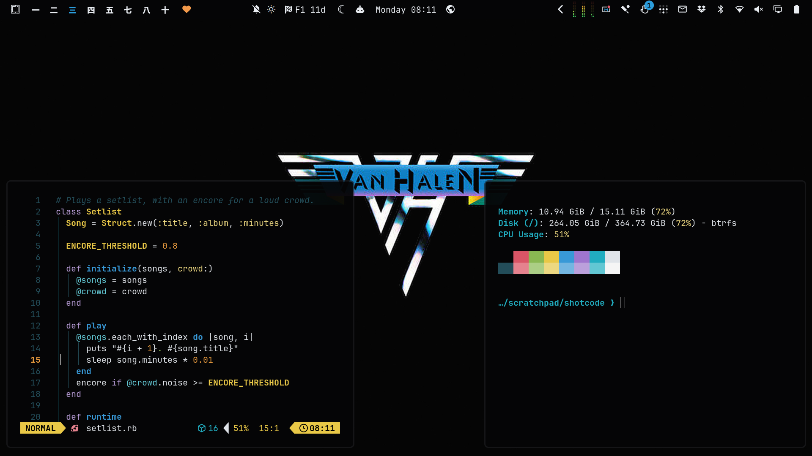
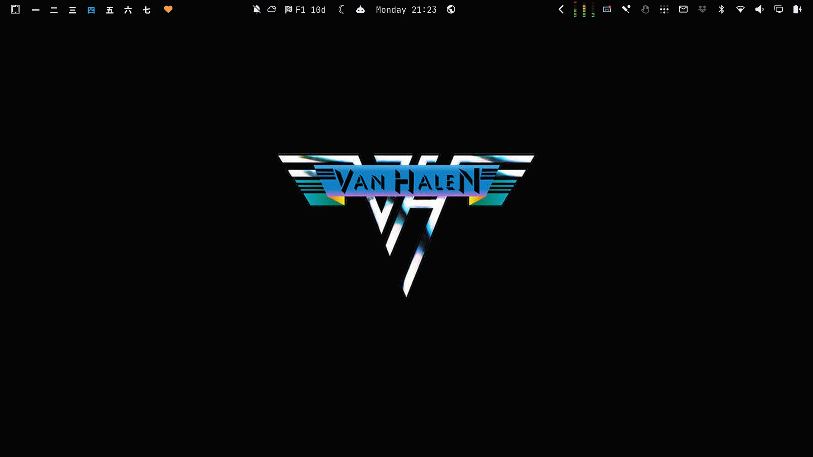
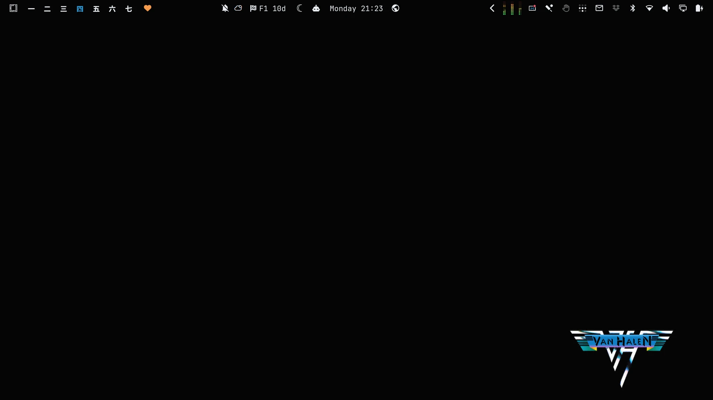
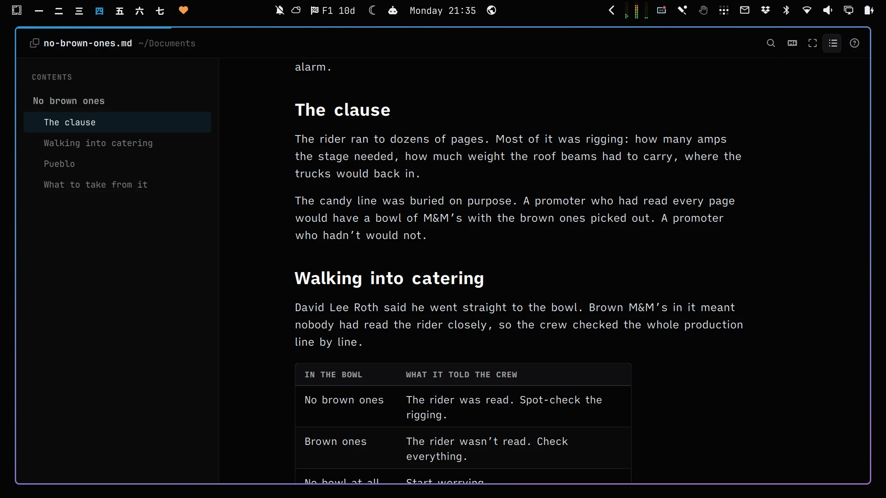
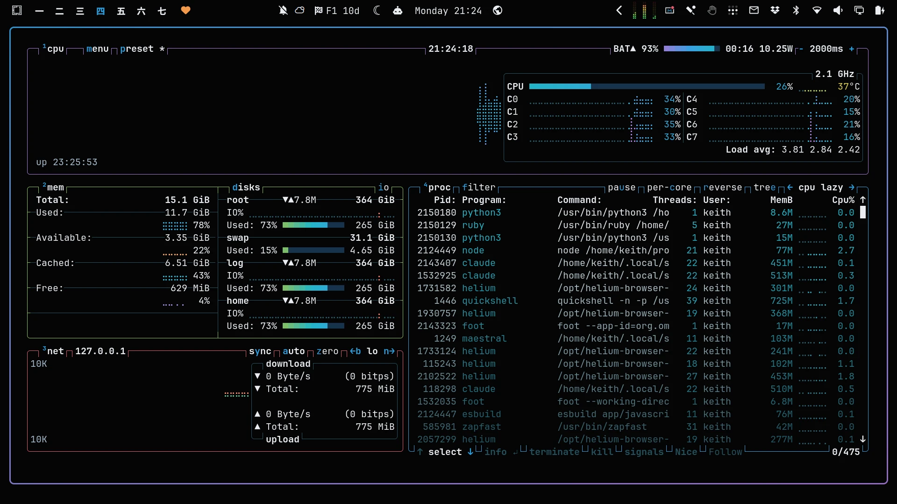

# Van Halen I

An [Omarchy](https://omarchy.org/) theme from the winged logo on Van Halen's first album, *Van Halen* (Warner Bros., 1978). The background is the sleeve's black. Text is the chrome of the wings, and the accent is the blue of the banner.



## Install

```bash
omarchy theme install https://github.com/keithrowell/omarchy-van-halen-i-theme
```

## Backgrounds

<p>


</p>

## OmarkyReader

[OmarkyReader](https://github.com/keithrowell/omarky) reads Markdown in the theme's colours.



## btop



## Licence

The theme files are MIT licensed, see [LICENSE](LICENSE). The wallpapers and screenshots are built from the album artwork, which belongs to its rights holders. This is an unofficial fan theme.
